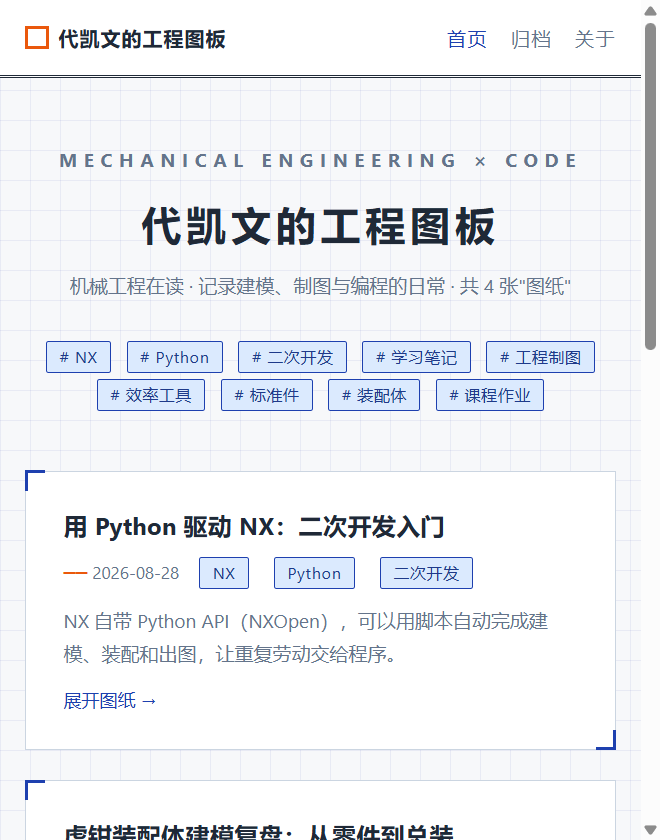

# 代凯文的工程图板

> 一个不用数据库的个人技术博客：每篇文章就是一个 Markdown 文件，Flask 在请求时把它读出来渲染成页面；同一套代码还能导出成静态站，直接扔到静态托管上。



## 一、在线地址

<https://welcome-crocodile-d75ecc93ae662-1516600636.tcloudbaseapp.com/>

线上跑的是本项目导出的静态版（`dist/`），托管在腾讯云开发 CloudBase 静态网站托管，使用默认域名，未绑定自有域名。

## 二、功能列表

- **首页文章列表** —— 按日期倒序排列，顶部是从全部文章自动汇总去重生成的标签云
- **文章详情** —— Markdown 渲染成 HTML，同时展示标题、日期、标签、摘要；文章不存在时返回 404
- **归档页** —— 把全部文章按时间倒序列成时间线
- **标签筛选** —— `/tag/<tag>/` 只看某个标签下的文章
- **关于页** —— 静态介绍页
- **自定义 404** —— 未知路径返回友好错误页，不暴露堆栈
- **零数据库写作** —— 往 `posts/` 丢一个带元信息的 `.md` 就完成发文，不改代码、不重启服务
- **安全响应头** —— 每条响应都带 `Content-Security-Policy`、`X-Frame-Options: DENY`、`X-Content-Type-Options: nosniff`、`Referrer-Policy`
- **静态导出** —— `dist/` 下是已导出的 17 个静态页面（首页、4 篇文章、归档、关于、9 个标签页、404），可直接放到任意静态托管

## 三、技术栈与目录结构

| 层 | 选型 |
|---|---|
| 语言 / 运行时 | Python 3.12 |
| Web 框架 | Flask 3.1.3 |
| 模板引擎 | Jinja2（模板继承，公共骨架在 `base.html`） |
| Markdown | markdown 3.10.3，启用 `extra` / `meta` / `toc` 扩展 |
| 数据库 | 无 |

路由一览（`app.py` 共注册 6 条路由 + 1 个 404 处理器）：

| 路由 | 说明 |
|---|---|
| `/` | 首页：文章列表 + 标签云 |
| `/post/<slug>/` | 文章详情，`slug` 即 `.md` 的文件名；不存在返回 404 |
| `/archive/` | 归档页 |
| `/tag/<tag>/` | 按标签筛选 |
| `/about/` | 关于页 |
| `/static/<path>` | 静态资源（Flask 内置） |

```
blog/
├── app.py                 # 入口：路由、文章解析、安全响应头、404
├── requirements.txt       # 依赖清单
├── README.md              # 本文件
├── .gitignore
├── posts/                 # 4 篇 Markdown 文章 —— 内容源在这里
│   ├── engineering-drawing-basics.md
│   ├── gb-standard-parts.md
│   ├── nx-python-automation.md
│   └── vise-assembly-notes.md
├── templates/             # 7 个 Jinja2 模板
│   ├── base.html          # 公共骨架：导航、标题栏、页脚
│   ├── index.html         # 首页：文章卡片 + 标签云
│   ├── post.html          # 文章详情
│   ├── archive.html       # 归档
│   ├── tag.html           # 标签筛选
│   ├── about.html         # 关于
│   └── 404.html           # 错误页
├── static/
│   ├── css/style.css      # 工程图纸蓝图风样式
│   └── assets/            # banner.svg、logo.svg
├── docs/                  # README 用的截图
└── dist/                  # 静态导出产物（线上托管的就是这一份）
```

## 四、本地运行方法

```bash
# 1. 安装依赖（需要 Python 3.9+，本项目在 3.12 下开发；Flask 3.x 已不支持 3.8）
pip install -r requirements.txt

# 2. 启动
python app.py
```

浏览器打开 <http://127.0.0.1:5000>，`Ctrl + C` 停止。

**新增一篇文章**：在 `posts/` 下新建 `.md`，头部写元信息，正文写 Markdown，刷新页面即可，无需重启。

```
title: 文章标题
date: 2026-08-20
tags: Python, Flask
summary: 一句话摘要
```

**只想看静态版**：

```bash
cd dist
python -m http.server 8000
# 打开 http://127.0.0.1:8000
```

> `dist/` 里的资源引用是 `/static/...` 这种以站点根目录为准的绝对路径，所以不要直接双击 HTML 文件，要放到网站根目录，或者像上面这样起个本地静态服务器。

## 五、已知问题与后续计划

**已知问题**

1. **每个请求都会重复解析全部文章**：`load_posts()` 在首页、归档、标签页和模板注入器里各调一次，一次请求可能把 4 个 `.md` 读两遍再解析两遍。文章只有 4 篇时感知不到，上百篇会明显变慢。
2. **依赖没锁版本**：`requirements.txt` 写的是 `>=`，换台机器可能装到不兼容的新大版本。
3. **用的是 Flask 开发服务器**：`app.run(debug=False, host="127.0.0.1", port=5000)`，只适合本机调试；上线要换 waitress / gunicorn 并关掉 debug。
4. **没有搜索、分页和 RSS**：文章多了列表页会一屏到底。
5. **`dist/` 要手动重新导出**：改了 `.md` 不会自动更新静态版，导出流程也还没脚本化。

**后续计划**

- [ ] 给 `load_posts()` 加一层缓存，按文件 mtime 失效
- [ ] `requirements.txt` 改成精确版本号
- [ ] 写 `export_static.py`，把静态导出脚本化，改完文章一条命令重建 `dist/`
- [ ] 加 RSS 与站内搜索
- [ ] 生产部署换成 waitress + 反向代理
